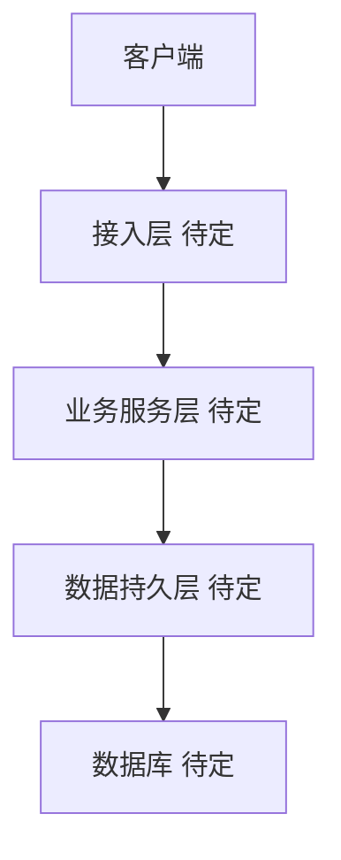
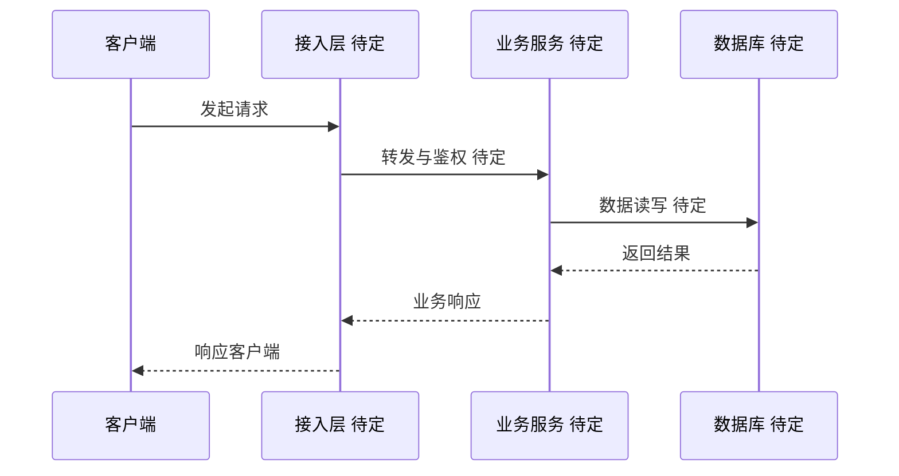

<div align="center">

# id_x_004: CDC-学生管理系统

**结构体_004 —— CDC 学生管理系统，预留项目骨架，待后续填充业务逻辑**


</div>

---

## 1. 简介 (Introduction)

**结构体_004 —— CDC 学生管理系统，预留项目骨架，待后续填充业务逻辑**

本项目为 CDC 学生管理系统的结构体占位（编号 id_x_004），隶属于 i-Core 组织，由 i-Torch 维护。当前仓库仅包含 LICENSE 文件（AGPL-3.0 协议），尚未填充具体业务代码。后续将在此基础上逐步实现学生信息管理、课程管理、成绩管理等核心业务逻辑。

## 2. 核心特性 (Features)

待规划。项目当前处于骨架阶段，核心特性尚未定义，待业务需求明确后补充。

## 3. 项目亮点 (Highlights)

待规划。项目当前处于骨架阶段，技术亮点与设计特色待后续补充。

## 4. 技术栈 (Tech Stack)

| 类别 | 技术选型 | 说明 |
| --- | --- | --- |
| 编程语言 | 待定 | 待规划 |
| 后端框架 | 待定 | 待规划 |
| 前端框架 | 待定 | 待规划 |
| 数据库 | 待定 | 待规划 |
| 引擎/运行时 | 待定 | 待规划 |
| 部署方式 | 待定 | 待规划 |

## 5. 整体架构图 (Overall Architecture Diagram)



> 当前为占位架构图，具体分层与组件待技术栈确定后完善。

## 6. 请求流转图 (Request Flow Diagram)



> 当前为占位流程图，具体请求链路待业务逻辑确定后完善。

## 7. 目录结构 (Directory Structure)

```text
id_x_004/
├── LICENSE          # AGPL-3.0 开源协议
└── README.md        # 项目说明文档
```

> 项目当前为最小骨架结构，业务代码目录待后续填充。

## 8. API 接口文档 (API Documentation)

待规划。项目尚未实现业务接口，API 文档将在接口设计确定后补充。

## 9. 快速部署 (Quick Deploy)

待规划。项目当前仅包含 LICENSE 文件，尚无可部署内容，部署说明将在业务代码填充后补充。

---

<div align="center">

**License: AGPL-3.0 | Author: i-Torch | Org: i-Core**

</div>
